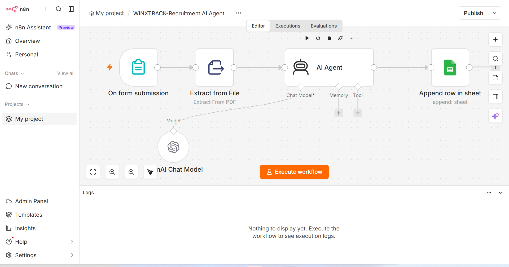
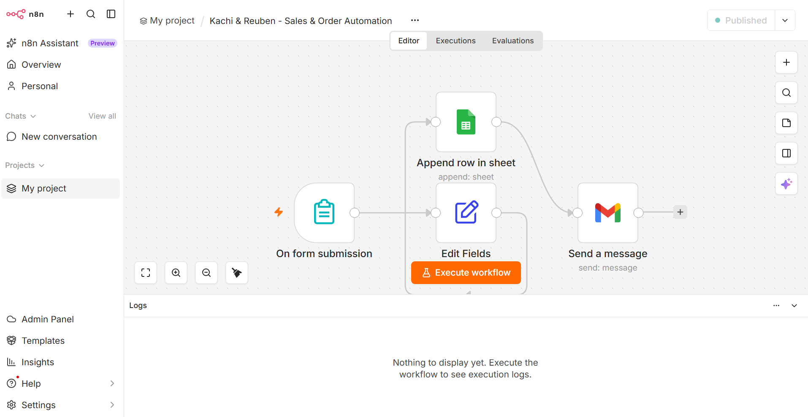
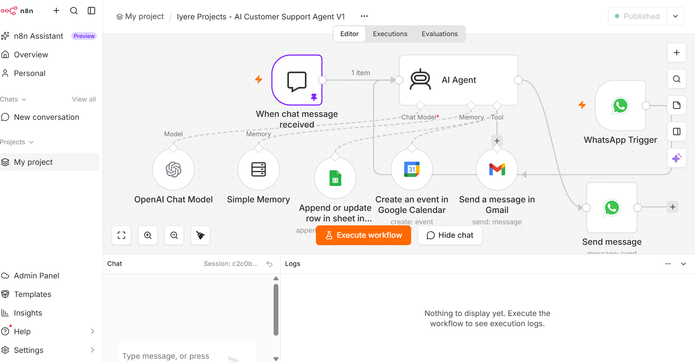

# Steven Iyere | AI Automation & Workflow Portfolio

**n8n automation • Business process design • AI-assisted operations • Integrations & troubleshooting**

I design practical automation workflows that help businesses capture information, organize records, coordinate follow-ups and reduce repetitive work. My projects cover recruitment, lead management, customer orders, Salesforce Flow and real-estate CRM/booking workflow design, with an additional background in AI-assisted digital production.

**Based in Lagos, Nigeria | Open to global remote and contract opportunities**

## Creative Copywriting & Storytelling Portfolio

For creative writing roles, see my **[dedicated storytelling and copywriting portfolio](creative-writing-portfolio/README.md)**, featuring six original samples: mystery video scripting, children's animation, brand copy, a three-email outreach sequence, launch-page copy and cross-platform social content.

## Featured Automation Projects

| Project | Business challenge | Workflow | Evidence |
| --- | --- | --- | --- |
| [Winxtrack — Recruitment Intake](projects/winxtrack-recruitment.md) | Collect applications and organize candidate information | Form → n8n → Google Sheets / email, with AI-assisted screening design | [Workflow image](winxtrack-ai-recruitment-agent.png) |
| [Kachi & Reuben — Sales Order Intake](projects/kachi-reuben.md) | Standardize product orders and customer details | Form → n8n → Google Sheets → Gmail | [Workflow image](kachi-reuben-sales-order-automation.png) |
| [Iyere Projects — Lead Management](projects/iyere-projects.md) | Centralize inquiries and support timely follow-up | Form → n8n → Google Sheets; tested calendar follow-up | [Workflow image](iyere-ai-customer-support-agent.png) |
| [Salesforce — Automated Lead Qualification](projects/salesforce-lead-qualification.md) | Categorize incoming project leads by budget | Active Salesforce record-triggered Flow → Decision → Lead Category assignment | [Workflow image](Salesforce%20Flow%20Automation.png) · [Case study](projects/salesforce-lead-qualification.md) |
| [Real Estate — CRM Lead Intake & Inspection Booking Pilot](projects/real-estate-lead-inspection-automation.md) | Centralize enquiries across five services and build a safe viewing workflow | n8n webhook → normalization / qualification → Google Sheets CRM; Google Calendar booking template in progress | [Case study and test status](projects/real-estate-lead-inspection-automation.md) |

### Winxtrack — Recruitment Workflow

### Kachi & Reuben — Order Workflow

### Iyere Projects — Lead Workflow

### Salesforce — Automated Lead Qualification Workflow

[Read the Salesforce case study and verified test results](projects/salesforce-lead-qualification.md)

### Real Estate — Lead Intake & Inspection Automation (pilot)
A synthetic n8n lead-intake test successfully wrote a classified real-estate enquiry to Google Sheets. The inspection-booking workflow is still under configuration/testing; **booking and WhatsApp automation are not live**. [Read the architecture, test evidence and deployment checklist](projects/real-estate-lead-inspection-automation.md).

## Reproducible Code & Unit Tests

**[Real-estate automation technical demo](examples/real-estate-lead-intake/README.md)** — importable, inactive n8n webhook workflow; standalone JavaScript for five-service lead qualification; and nine unit tests covering boundary budgets, validation and repeat inputs. All nine JavaScript test bodies passed in an isolated test harness. The n8n demo has **not** been executed against live credentials or presented as a production system.

[View n8n workflow JSON](examples/real-estate-lead-intake/n8n-lead-intake-demo.json) · [View JavaScript source](examples/real-estate-lead-intake/qualify-lead.mjs) · [View tests](examples/real-estate-lead-intake/qualify-lead.test.mjs)

## Additional Experience

[AI-Assisted Digital Production & Localization](projects/ai-digital-production.md) — speaker management, dubbing synchronization, quality assurance and troubleshooting in multilingual production.

## Technical Capabilities

- **Automation:** n8n, Salesforce Flow Builder, record-triggered flows, form triggers, workflow orchestration, field mapping and conditional workflow design
- **Integrations:** Google Sheets, Gmail, Google Calendar; exploratory Meta/WhatsApp API configuration
- **AI:** AI-agent experimentation, AI-assisted processing, prompt engineering and human review
- **Delivery:** iterative testing, troubleshooting, documentation and business-process analysis

**Reliability focus:** I am expanding my production automation practice to include systematic input validation, error workflows, retry/backoff policies, duplicate prevention, monitoring and recovery. These are **areas for further implementation**, not claims that every portfolio workflow already includes them.

## How I Work

1. Understand the business process and identify repetitive tasks.
2. Define intake fields, outputs and integration points.
3. Build the workflow and map data between services.
4. Test sample submissions and fix integration or data-mapping problems.
5. Document what works, what remains experimental and what should be improved before production deployment.

## Project Status & Evidence

These are selected project case studies, not downloadable production deployments. Screenshots illustrate workflow structure. Some components were tested, while others remain planned or experimental; each case study distinguishes them. No production credentials, personal customer records or candidate CVs are published.

## Contact & Availability

**GitHub:** [okikisteve](https://github.com/okikisteve)  
**Location:** Lagos, Nigeria  
**Interested in:** Remote automation specialist, AI operations, n8n workflow development and related contract roles.
