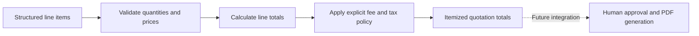

# Quotation Cost Controls — JavaScript Demo

**Status:** Standalone portfolio demonstration · nine local Node.js tests passed on 24 November 2026. Not a production invoicing or accounting system.

## Business problem
Interior finishing and construction estimates often combine square-metre rates, quantities and lump-sum services. Manual calculations can introduce inconsistent line totals, duplicated items, hidden charges and ambiguous tax bases.

This synthetic example models a transparent quotation calculation step that could later be called from an n8n Code node or a server-side quotation service.

## What it does
- Accepts unique line IDs, fractional quantities (thousandths of a unit), and unit prices in integer kobo.
- Calculates each line total using integer arithmetic and half-up rounding.
- Separately reports subtotal, admin fee, contingency, taxable amount, tax and grand total.
- Requires explicit tax rate and tax base; rejects missing/invalid policy, negative prices, duplicate IDs, zero quantities and unsafe monetary results.
- Uses a quantity of 1,000 thousandths for a lump-sum item.



## Example

```js
import { estimate } from './estimate.mjs';

const result = estimate(
  [{ id: 'demo', quantityMilli: 2500, unitPriceKobo: 40000 }],
  { adminBps: 1000, contingencyBps: 500, taxBps: 750, taxBase: 'subtotal' }
);
console.log(result.grandTotalKobo); // 122500 (NGN 1,225.00)
```

All sample data and rates are illustrative, not a client quotation or tax advice. Admin and contingency both use the rounded line subtotal. Tax may apply to the subtotal alone or the subtotal plus both charges, depending on the explicitly selected policy. Actual tax treatment must be independently reviewed before use.

## Reproduce the tests

From the repository root using Node.js 22+:

```bash
node --test examples/quotation-cost-controls/estimate.test.mjs
```

The nine tests cover fractional quantity, alternate tax base, rounding, lump sums, duplicate IDs, invalid quantities/prices, missing or invalid tax policy, numeric overflow and empty/noninteger input.

[Source](estimate.mjs) · [Tests](estimate.test.mjs)

## Limits and next steps

No customer data, actual client pricing, PDF generator, live n8n workflow, accounting connection, invoice issuance or payment processing is included. A production workflow would need independently reviewed tax rules, authorization, audit logging, versioning, persistence, and human approval.

[Back to the portfolio](../../README.md)
