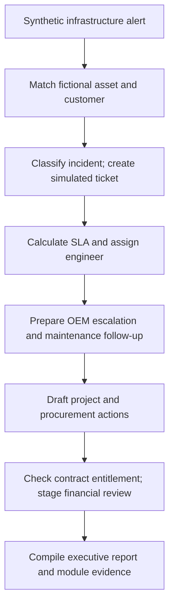

# Enterprise IT Operations — 12-Module n8n Simulation

**Portfolio case study | 8 November 2026 | Internal demonstration only**

**Status:** A 12-module operational workflow was exercised against **fictional records in an isolated n8n simulation**. This is **not a live customer deployment**. No external service was changed, no email was sent, no purchase was placed, and no connected customer system was accessed.

**Prepared as:** Omnify AI — enterprise operations automation concept.

## Business problem

IT service businesses can manage tickets, service-level agreements, engineer assignments, original equipment manufacturer (OEM) escalations, assets, preventive maintenance, projects, procurement, contracts and reporting in disconnected systems. The goal of this prototype was to demonstrate how a single incident could drive a coordinated, auditable sequence of operational decisions.

## Demo architecture



All steps above operated on **mock data**. "Create," "assign," "approve" and "escalate" mean simulated records or draft decisions, **not** actions in a production application.

## Modules evaluated

| Module | Capability | Demonstrated result (simulation only) |
| --- | --- | --- |
| 01 | Customer management | Matched incident to a fictional customer |
| 02 | Support and incident triage | Classified a test fault and drafted a ticket |
| 03 | SLA management | Calculated a deadline and staged a warning |
| 04 | Engineer assignment | Matched a sample engineer by skill and workload |
| 05 | OEM support/escalation | Drafted an escalation and scripted an approval |
| 06 | Monitoring integration | Accepted a fictional device alert |
| 07 | Asset and service records | Associated a sample asset with its customer |
| 08 | Preventive maintenance | Prepared a follow-up maintenance task |
| 09 | Project management | Drafted a coordination task |
| 10 | Procurement and approvals | Staged a fictional replacement request |
| 11 | Contract and financial workflows | Evaluated sample entitlement and staged review |
| 12 | Executive operational reporting | Consolidated simulated actions into a report |

Seven capabilities formed the initial requested module scope; five additional modules were proposed to illustrate a unified operating model. Proposed additions remain subject to business approval and integration discovery.

## Observed test evidence

The n8n demo generated structured JSON evidence on **8 November 2026** for a **single synthetic infrastructure-fault scenario**:

- **12 of 12 module result entries** were returned, each marked `simulated`.
- **1 fictional incident** was processed; the demo report recorded **12 module actions** and a separate initialization entry.
- `simulation: true`, `treten_connected: false`, `external_actions_performed: false`.
- The exported classification mode was **`deterministic_rules_only`**. This run does **not** prove that a production LLM made a decision.
- Scripted approvals represent test branches, not real manager authorization.

### Redacted evidence shape

```json
{
  "scenario": "infrastructure_fault",
  "simulation": true,
  "customer_system_connected": false,
  "external_actions_performed": false,
  "classification": "deterministic_rules_only",
  "demonstration_status": "all_12_modules_evaluated",
  "module_count": 12,
  "module_status": "simulated"
}
```

The JSON above is a **sanitized summary**, not a verbatim exported run file or an importable workflow. Full internal evidence can be reviewed privately where disclosure is authorized.

## Engineering approach

1. Model common entities: customer, asset, alert, incident, SLA, engineer, task and evidence.
2. Build deterministic sample records and a fixed infrastructure-fault scenario.
3. Route the scenario through 12 scoped decision stages.
4. Capture a structured result for each module and aggregate reporting output.
5. Explicitly tag simulated decisions and external-action status so test results cannot be mistaken for deployment.

## What remains before a live implementation

- Approve the module scope and confirm real business rules.
- Obtain authorized sandbox access, API contracts and data-mapping requirements.
- Connect permitted Zoho/CRM, monitoring, email and service-management systems (none were live in this demonstration).
- Replace scripted approvals with authenticated human approval gates.
- Test error handling, permissions, deduplication, retries, audit trails and recovery.
- Validate a dashboard against authorized data, then run supervised acceptance tests.

**Portfolio disclosure:** This public case study intentionally omits client names, contacts, tickets, credentials, webhook endpoints, raw internal exports and confidential configuration. It demonstrates **simulation design, orchestration and honest test reporting**, not a deployed enterprise product.
