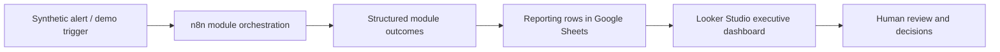

# Executive Operations Dashboard — Reporting Prototype

**Sanitized portfolio case study | November 2026 | Demo / work in progress**

## Business objective

Give operations leaders a consolidated view of **what triggered, which workflow stages ran, what needs attention, and what each stage produced**, without opening individual automation nodes.

This reporting concept accompanies the [12-module enterprise IT operations simulation](enterprise-it-operations-simulation.md). It is a **demonstration and dashboard prototype**, not evidence of a production customer implementation.

## Demonstration architecture



The n8n demonstration models 12 operational modules, including incident triage, SLA tracking, engineer assignment, escalation, maintenance and executive reporting. Google Sheets and Looker Studio are the **reporting design stack** for the executive view. Connection to a real customer's Zoho environment or production monitoring systems **has not been established by this public evidence**.

## Dashboard views and questions

| Proposed view | Question answered | Example indicators |
| --- | --- | --- |
| Operations overview | What happened in the latest demonstration run? | Run ID, run time, module completion count |
| Incident response | Which issues need urgent follow-up? | Severity / priority, triage outcome, SLA risk |
| Work assignment | Who or what would handle the next step? | Assigned function, action type, decision status |
| Escalations and approvals | Which actions require authorization? | Pending decision, escalation type, proposed owner |
| Module activity | Which workflow stages produced an output? | Module ID, status, summary, error or note |
| Reporting history | How do test outcomes change across runs? | Simulated runs, statuses and timestamp filters |

## Example reporting contract

The following JSON is **illustrative and fictional**. It is not a copy of a customer's data or a claim that every field has already been deployed.

```json
{
  "run_id": "DEMO-2026-001",
  "event_time": "2026-11-12T09:00:00+01:00",
  "module_id": "M03",
  "module_name": "SLA management",
  "event_type": "incident_review",
  "priority": "high",
  "status": "simulated",
  "sla_risk": "at_risk",
  "action_required": "manager_review",
  "source_mode": "synthetic_demo",
  "external_actions_performed": false
}
```

A useful engineering next step is to standardize these columns across modules, ensure each event has a stable `run_id`, and validate counts against the n8n execution summary before using them in charts.

## Status and boundaries

**Demonstrated:** A controlled, fictional incident scenario produced structured outcomes for 12 simulated n8n modules on 8 November 2026.

**Portfolio design work:** A Google Sheets → Looker Studio reporting approach and executive report layout have been explored. This document describes the reporting model and dashboard questions; it does **not** claim that all dashboard indicators are connected, refreshed, or independently verified.

**Still required for production:** Authorized APIs and permissions, reliable event ingestion, timestamp and status definitions, operational data validation, duplicate protection, failure monitoring, access control, human approval gates and user acceptance testing.

## Public-disclosure precautions

No customer names, incident records, credentials, internal dashboard URLs, API keys, webhook endpoints, employee information, proprietary exports or screenshots containing private information are included.

**Related:** [12-module enterprise simulation](enterprise-it-operations-simulation.md) · [Automation portfolio overview](../README.md)
