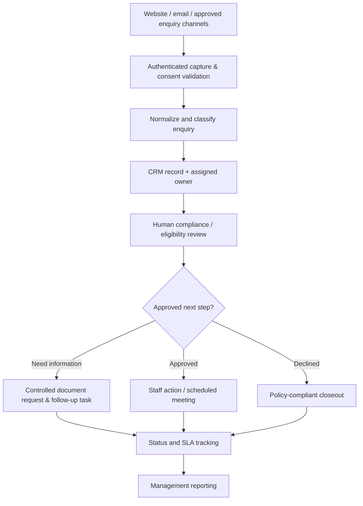

# Investment-Services Operations — Automation Discovery & Proposal Case Study

**Category:** Business analysis · Process mapping · AI operations strategy · CRM and reporting design  
**Stage:** Discovery and proposal only (November 2026). **No client integration, implementation, or operational ROI has been verified.**

## Brief

Developed an **anonymized business-automation opportunity assessment** for an investment-services website and business context. The proposed value was to translate enquiries, document-heavy operational processes and fragmented follow-up into a measurable, controlled digital workflow.

This is a **strategy and architecture portfolio case study**. It does not reproduce any confidential client documents, endorse a particular business, or claim inside knowledge of its internal systems.

## Problem hypotheses for discovery

These are potential issues to validate with stakeholders, not verified facts about a client:

1. Enquiries arriving from web forms, phone, email or messaging may be recorded inconsistently.
2. Sales and operations teams may lack a single status view of handoffs, document requests and pending approvals.
3. Manual reminders can create follow-up gaps and unclear ownership.
4. Executive reporting may depend on reconciliation across disconnected spreadsheets or message threads.

## Proposed workflow

**AI boundaries:** An AI assistant could help categorize routine enquiry text, draft responses, summarize unstructured internal notes and flag missing fields. It **must not** approve investments, make financial promises, determine regulatory compliance or represent a human decision as final.

## Example implementation plan (proposed, not deployed)

| Phase | Capability | Measurable acceptance criteria |
| --- | --- | --- |
| 1 — Discovery | Confirm process owners, approved data fields, consent and handoff rules | Signed workflow map and data-access approvals |
| 2 — CRM intake | Standardize new enquiries and prevent accidental re-entry | Synthetic test cases and successful non-duplicate CRM write |
| 3 — Operations | Assignment, follow-up reminders and exception queues | Testable queue ownership, escalation and failure logging |
| 4 — Human-controlled AI | Draft / triage assistance with review before external action | Audit logs show model suggestions separate from approvals |
| 5 — Visibility | Pipeline, response times, overdue tasks, rejection reasons | Stakeholder-approved dashboard calculations and test reconciliation |

## Suggested KPI design

- New enquiries by source and service category.
- Time to first human response and percentage within agreed service window.
- Percentage of records with required fields and documented consent.
- Number of overdue follow-ups and exception queue age.
- Conversion stages after human verification (avoiding misleading automated-approval counts).
- Automation failure rate and cases requiring human intervention.

Any time savings, conversion improvement or cost reduction would require a verified baseline and a controlled pilot; **no percentage improvement is claimed here**.

## Controls to address before deployment

- Data minimization, access permissions and retention policies.
- Applicable Nigeria data-protection and financial-services requirements, confirmed by qualified legal/compliance teams.
- Responsible escalation for sensitive financial queries or complaints.
- Explicit human authorization before financial, contractual or customer-affecting actions.
- Duplicate handling, authenticated webhooks, error recovery and delivery audit logs.

## What this demonstrates

Business process discovery · Proposal and scope development · Human-in-the-loop workflow design · CRM architecture · Operational dashboard requirements · Risk-aware AI deployment planning · Stakeholder-oriented technical writing.

**Transparency:** This is an anonymized design exercise reflecting proposal work, **not** proof that a particular investment firm commissioned, accepted, implemented or benefited from the solution.

[Return to the main portfolio](../README.md).
