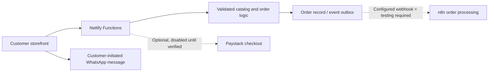

# Kachi & Reuben — Menswear Commerce Platform (Preview)

**Category:** E-commerce prototyping · Serverless JavaScript · Workflow integrations · Product operations  
**Status:** Code and deployment instructions maintained in a **private repository**. Storefront deployment was reported on 24 November 2026; public availability and end-to-end payment processing have not been independently verified.

## Business context

Kachi & Reuben is a **men's-wear-only** fashion concept centered on masculine style, design, confidence and African heritage. The objective is to connect a premium digital catalog with order intake, owner-managed product information, optional payment processing and downstream operational automation.

## Implemented in the private project

- **Responsive storefront concept:** Browse product artwork, select sizes and quantities, and initiate an order enquiry.
- **Private Product Studio:** Owner-facing administration interface for catalog management; requires deployment configuration and credential setup.
- **Server-side order intake:** Netlify Functions validate requests, create a reference number and store order information in Netlify Blobs.
- **Paystack payment integration code:** Checkout initialization uses server-held credentials and authoritative prices; webhook and verification logic are designed to validate transaction details before marking an order paid. **No real payment or live merchant configuration is claimed.**
- **Asynchronous n8n handoff:** A persisted event outbox is designed to queue order and payment-state events, with a scheduled retry mechanism. Connecting the receiver and proving an end-to-end synchronization remain deployment tasks.
- **WhatsApp contact handoff:** Prepares a product/size enquiry for the customer to send manually. Opening WhatsApp is **not** evidence of a message sent or an order confirmed.

## November 2026 progress update

- A 24 November GitHub commit was verified in the private source repository: four enhanced product images were connected to homepage and collection cards.
- Netlify publication was reported; live visual QA and custom-domain reachability remain to be verified.
- Customer enquiry acknowledgment was observed in testing; this is not a paid order or stock reservation. Delivery of the corresponding business notification remains unresolved.

## Simplified architecture

## Current limitations and production safeguards

The present catalog contains **illustrative product listings**; prices and stock have not been confirmed for live selling. Online checkout is disabled by default, and the code requires verified products, inventory, delivery terms, approved merchant configuration, end-to-end payment tests, privacy policy and operational monitoring before launch.

The server-side design deliberately avoids treating browser-submitted amounts, payment screenshots or redirect URLs as authoritative payment confirmation. It also avoids claiming automatic WhatsApp messaging, live stock reservation, shipping integrations or completed n8n synchronization.

## Skills demonstrated

HTML/CSS/JavaScript · Netlify Functions · Server-side validation · Event-driven order processing · Structured product data · Payment-flow security concepts · n8n integration design · UX copy and creative direction · Adobe Photoshop / AI-assisted design

## Source and confidentiality

The working source repository is **private**. This case study describes non-secret architecture and verified repository features only; it does not publish customer details, passwords, API keys, payment credentials or private checkout endpoints.

[Back to the automation portfolio](../README.md)
