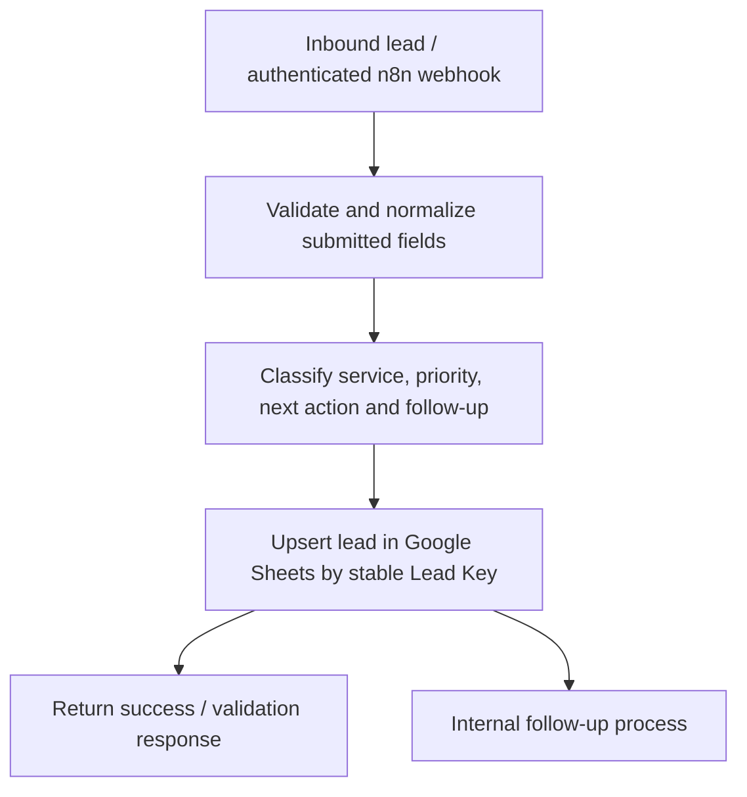
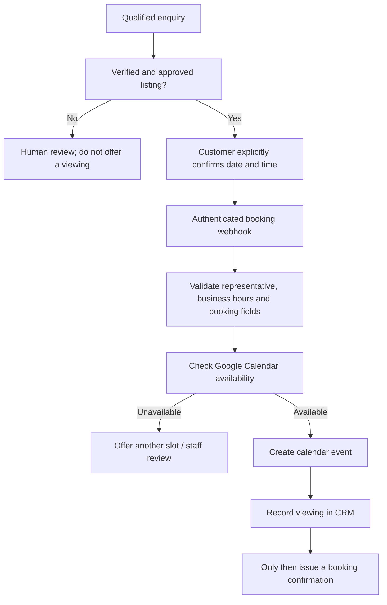

# Real Estate Lead Intake & Inspection Booking — n8n + Google Sheets

**Portfolio case study | October 2026 | Pilot / in progress**

**Context:** Anonymized real estate-business workflow in Lagos, Nigeria. The business needed a single intake process for land purchases, house purchases, rentals, joint ventures, and construction enquiries, plus a controlled path to property inspections.

**Stack:** n8n Cloud · Webhooks · JavaScript/JSON data normalization · Google Sheets CRM · Google Calendar integration design · WhatsApp Business Cloud API (planned)

> **Current state (28 October 2026):** A synthetic end-to-end lead intake test successfully added a classified record to the connected Google Sheets CRM. The inspection-booking workflow template has been prepared/imported for configuration, but a successful live booking has **not** been verified. WhatsApp messaging, live property listings, and automated daily email reminders are **not** claimed as live.

## Business problem

Prospective clients contact real estate teams about different services. Without consistent intake, staff can lose enquiries, miss follow-ups, or book viewings for properties that have not been verified. The objective was to keep all enquiries in one structured CRM and introduce a safe path from lead qualification to appointment booking.

## Lead intake architecture — tested with synthetic data

The CRM design includes structured lead fields, a property inventory, viewing records, and separate pipelines for joint ventures and construction. On repeat enquiries, the workflow uses a stable lead key to update relevant intake data without intentionally overwriting manually maintained sales-stage/notes fields. Lead allocation currently follows a **single-representative** model; it is not presented as a multi-agent routing system.

### What was tested

| Test | Observed outcome | Evidence status |
| --- | --- | --- |
| Synthetic land-sales lead submitted to the n8n intake | Request processed | Confirmed in development |
| Qualification and priority mapping | Lead classified as high priority | Confirmed in CRM record |
| Google Sheets persistence | Lead row created with service, location, lead stage and assigned representative | Confirmed in CRM record |
| Duplicate/retry cases | Not yet independently verified in published evidence | Further testing required |
| Production WhatsApp enquiry | Not tested | Integration pending |

**Data hygiene:** This public summary intentionally excludes customer identities, sales-representative contact details, private CRM identifiers, webhook URLs, access tokens and client-specific workflow exports.

## Inspection booking architecture — configured template, not live

The proposed booking rules cover **Monday–Saturday, 09:00–18:00 West Africa Time**, a **free viewing**, one authorized representative, and a requirement for explicit customer confirmation. Listing validity, calendar credentials, conflict handling, duplicate booking controls and consistency between calendar events and CRM records need real end-to-end tests before the booking workflow can be published.

A separate daily follow-up email digest and conversational intake prompt were drafted as additional components; these are **not live operational claims**.

## Engineering decisions and risk controls

- **Single CRM source of truth:** centralizes enquiries across five distinct service lines.
- **Structured inputs:** validates service, contact fields, locations and enquiry details before CRM writes.
- **Upsert instead of blind append:** reduces repeated lead rows when the same stable key is submitted.
- **Human-in-the-loop property checks:** prevents the system from suggesting unverified listings.
- **Consent before booking:** requires explicit customer agreement to the specific property and slot.
- **Safe public documentation:** no real lead information, company secrets, private sheet URLs or operational tokens are released.
- **Reliability work still required:** re-check availability, control simultaneous requests, reconcile calendar/CRM write failures, and test idempotency before production use.

## Next implementation milestones

1. Run synthetic negative tests for malformed lead submissions, duplicates and retries.
2. Connect a permitted test property listing and authorized representative's test calendar.
3. Verify valid booking, Sundays/out-of-hours rejection, busy-slot rejection, and duplicate booking rejection.
4. Add monitoring, error alerts, duplicate prevention and calendar/CRM reconciliation.
5. Configure approved messaging channels, verify consent and security, then run supervised pilot tests.

## Skills demonstrated

Business process discovery · Requirements mapping · n8n workflow orchestration · Webhooks · JSON/JavaScript transformations · Google Sheets CRM integration · Conditional routing · Lead prioritization · Data validation · Test design · Architecture documentation

*This case study describes a verified lead-intake milestone and a booking workflow under implementation; it is not evidence of a fully deployed customer-facing real estate system.*
