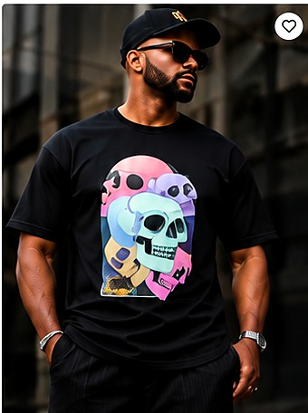

# Steven Iyere | Photo & Visual Editing Portfolio

**Creative visual direction · Adobe Photoshop familiarity · AI-assisted image editing · Commercial visual presentation**

Lagos, Nigeria | Available for remote contract work

This portfolio focuses on visual composition, image selection, creative refinement, fashion presentation and architectural visualization. The work below distinguishes AI-assisted concept development and storefront presentation from traditional photographic retouching.

## 01 — Menswear campaign: image selection and composition

**Brief:** Present a premium men's fashion concept with a restrained palette, clean hierarchy and a consistent visual identity.

| Selected storefront image | Campaign layout |
| :---: | :---: |
|  |  |

**Visual review:** Framing, focal point, negative space, legibility, palette consistency and adapting a portrait to a wide-format campaign cover.

**Evidence:** Existing illustrative storefront assets from the Kachi & Reuben commerce prototype. The pair demonstrates image selection and layout adaptation, not a verified raw-photo-to-retouched-photo comparison. No claim is made that I photographed the model or performed a particular manual retouch.

## 02 — Graphic apparel visual presentation

**Brief:** Present a statement graphic in a menswear catalog while keeping the garment and artwork readable.

**Visual review:** Contrast, graphic placement, garment silhouette, thumbnail clarity and consistency with the storefront's visual language.

**Evidence:** Illustrative catalog preview asset, not a commissioned photography claim or proof of a print-ready production file.

[Related commerce platform case study](../projects/kachi-reuben-commerce-platform.md)

## 03 — AI-assisted interior visualization and iterative image refinement

**Concept study:** An industrial interior under a steel mezzanine was developed through successive AI-assisted visual revisions, including a continuous walnut feature wall and a furnished lounge variation with burgundy chairs, warm lighting and a coordinated seating composition.

**Visual review:** Maintaining structural cues across revisions, evaluating materials, lighting, perspective, visual consistency and the impact of furniture placement. These are concept renders, not photographs of completed construction.

*The visual studies were reviewed in the source conversation. Their image files are not yet included in this public gallery.*

## 04 — AI-assisted apparel artwork and conceptual illustration

**Concept studies:** Afrocentric apparel graphic concepts using typography, symbolism and high-contrast color; a textured moonlit illustration featuring three abstract figures, with iterative changes to the left figure's headwear.

**Visual review:** Prompt-directed revisions, composition, hierarchy, edge treatment, thematic consistency and comparison of visual alternatives.

*These are AI-assisted concepts, not verified hand-painted originals. Image files are not yet included in this public gallery.*

## Editing and image-quality approach

- Interpret the brief, desired audience, intended output and reference constraints.
- Assess framing, lighting, color balance, subject continuity, artifacts and distracting elements.
- Use appropriate editing or AI-assisted revision methods; compare variants against the source and brief.
- Check typography, visual hierarchy and output dimensions before handoff.
- Distinguish an AI-generated concept, a composition change and a conventional photo retouch; document the actual method used.

**Tools:** Adobe Photoshop (self-reported practical familiarity), AI-assisted image generation and editing, digital creative direction. Lightroom proficiency is not asserted.

## Education and professional learning

- B.Sc. Psychology, Covenant University, Nigeria.
- Oxford–UNESCO AI in the Public Sector — orientation and Modules 1–5 learning activities and quizzes completed; formal certificate issuance has not been verified.
- IBM short-course certificate — completion reported; exact course title and credential link pending verification.

## Scope and next additions

The published gallery contains selected storefront visual assets and descriptions of additional AI-assisted concepts. It does not yet include verified original-versus-edited portrait retouching pairs, Lightroom work or layered Photoshop source files. These can be added as available, with accurate process notes and permission for any client images.

[Main professional portfolio](../README.md) · [GitHub profile](https://github.com/okikisteve) · [LinkedIn](https://www.linkedin.com/in/emmanuel-okikie-i-8523743b6/)
